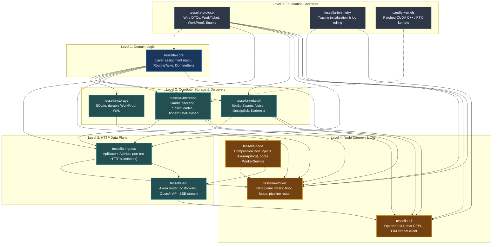
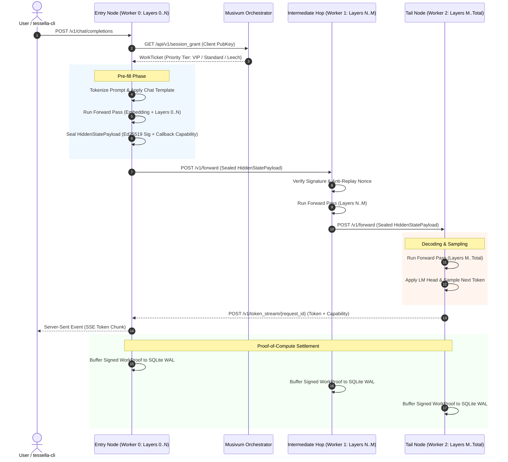

# 🏛️ Tessella Architecture: Data Plane & Distributed Inference

> Architectural specification and system invariants of the Tessella distributed AI inference network.

---

## 1. System Overview & Invariants

Tessella is the open-source **data plane** for distributed transformer inference. It partitions large language models across consumer and workstation GPUs connected in a peer-to-peer mesh.

```text
+-------------------------------------------------------------+
|             Musivum (Proprietary Control Plane)             |
|   Admission - Whole-Layer Assignment - Karma Ledger - DHT   |
+-------------------------------------------------------------+
                              |
       Registration, Heartbeats, Session Grants, WorkTickets
                              |
+-------------------------------------------------------------+
|              Tessella (Open-Source Data Plane)              |
|                                                             |
|   [Node 0 (Layers 0..8)]  --HTTP-->  [Node 1 (Layers 8..16)]|
|             |                                   |           |
|      Prompt Pre-fill                      Forward Pass      |
|             |                                   |           |
|             +------------ HTTP Token Stream <---+           |
+-------------------------------------------------------------+
```

### Core Invariants

1. **Control Plane vs. Data Plane Separation:**
   - **Musivum (Control Plane):** The proprietary orchestrator responsible for admission control, whole-layer partitioning, reputation scoring, sampled compute audits, and Karma settlement.
   - **Tessella (Data Plane):** The open-source compute client and CLI. Executes Candle tensor kernels, manages safetensor shards, and routes activation payloads between nodes over HTTP.
2. **Whole-Layer Pipeline Parallelism (`D-15`):**
   - Models are partitioned into **contiguous whole-layer blocks** (`layer_range: (usize, usize)`).
   - **Expert Parallelism is retired (`TASK-37`):** Sharding individual MoE experts across multiple nodes without full layer synchronization breaks attention gathering. All expert routing occurs locally within a node hosting the entire layer block.
3. **Dual Network Topology (`D-10`):**
   - **libp2p (Control/Topology):** Used exclusively for peer discovery (Kademlia DHT under `/tessella/kad/1.0.0`), node identity (Noise protocol + PeerId), and cluster state broadcasts (GossipSub).
   - **HTTP/1.1 (Tensor Transport):** Hidden state activations travel over HTTP (`POST /v1/forward`) carrying binary safetensor buffers (`HiddenStatePayload`). Tensors never traverse libp2p streams.
4. **Strict GPU-Only Execution (`D-6`):**
   - CPU execution is disallowed. Configuring `device = "cpu"` immediately aborts worker initialization.
5. **Dependent Liveness (`D-25`):**
   - Nodes require a reachable orchestrator to receive work. If the orchestrator is unreachable, nodes refuse requests within `registration_grace_secs` (300s) and do not serve autonomously.
6. **Discovery Source Precedence (`D-4`):**
   - The mesh view is fed in a fixed order: **tracker (`/peers`, `/register`+`/announce`) > GossipSub topology > Kademlia DHT > persistent peer cache (`known_peers`)**. The first two are authoritative and always overwrite; the persistent cache is only read when the routing table is empty (cold start, or tracker down).
   - **The DHT never admits a peer**: an unauthenticated `get_providers` answer may refresh the address of a peer already in the routing table, or trigger a dial for a model nobody covers, but admission is only `/register` (signed). It speaks its own protocol id (`/tessella/kad/1.0.0`), so it can never be confused with the public IPFS DHT.
   - The *bootstrap* dial order (persistent cache → tracker → mDNS) is a different question and lives in `tessella_network::kademlia::plan_bootstrap`.

---

## 2. Workspace Crate Architecture

The Tessella codebase is organized into a strictly layered, acyclic workspace:



> **The `tessella-worker → tessella-api` edge no longer exists (`SOLID-89`).** The daemon used to depend
> on `tessella-api` to call `start_api_server`, which forced the whole data plane to link Axum. The
> dependency is now inverted: `tessella-ingress` owns the **port** (`ApiHost`) and the HTTP **state**
> (`ApiState`) with no HTTP framework in sight; `tessella-api` implements the port
> (`axum_host::AxumApiHost`) and re-exports the state; and `tessella-node` — the composition root that
> still produces the `tessella-worker` binary — is the only package that links both.
> `cargo tree --invert tessella-api` lists `tessella-cli` and `tessella-node`, never `tessella-worker`.

### Responsibilities by Crate

| Crate | Responsibility |
| :--- | :--- |
| [`tessella-protocol`](../crates/protocol/README.md) | Shared RPC and wire contracts between worker and orchestrator. Zero dependencies on compute or storage. |
| [`tessella-core`](../crates/core/README.md) | Domain business logic: VRAM budgeting, layer range calculation, routing tables (`RoutingTable`, `LayerPeer`), common errors (`DomainError`), and service traits. |
| [`tessella-telemetry`](../crates/telemetry/README.md) | Structured logging and diagnostics initialization using `tracing` and `tracing-appender`. |
| [`tessella-storage`](../crates/storage/README.md) | SQLite persistence: durable Write-Ahead Log (`pending_work_proofs`), peer registry, and Hugging Face artifact tracking. |
| [`tessella-inference`](../crates/inference/README.md) | Tensor computation using Hugging Face `candle`. Supports `Qwen2ForCausalLM` and `Qwen2MoeForCausalLM`. Implements GQA, RoPE with absolute offsets, safetensors shard loading, sampling, and activation serialization (`HiddenStatePayload`). |
| [`tessella-network`](../crates/network/README.md) | P2P discovery and gossip layer via `libp2p` 0.53: Noise encryption, GossipSub mesh broadcast, and Kademlia DHT (`/tessella/kad/1.0.0`). |
| [`tessella-ingress`](../crates/ingress/README.md) | HTTP ingress **port**: the `ApiHost` trait the data plane calls to serve the HTTP surface, plus the shared `ApiState`/`MusivumState`/`RegisteredWorker` types and the `ApiAuth` re-exports. Zero HTTP framework: it is what keeps `tessella-api` out of the data plane (`SOLID-89`). |
| [`tessella-api`](../crates/api/README.md) | Axum adapter implementing the `ApiHost` port (`axum_host::AxumApiHost`): inter-hop tensor pipeline (`/v1/forward`), OpenAI-compatible chat completions (`/v1/chat/completions`), FIM completions, health reporting (`/status`), and single-use capability callbacks (`/v1/token_stream/{request_id}`). |
| [`tessella-worker`](../crates/worker/README.md) | Data-plane library: lifecycle orchestration (`WorkerService`), background registration loop, announce/heartbeat loop, HTTP pipeline routing with automatic failover, and the economy CLI implementation. It takes the HTTP surface as an injected `Arc<dyn ApiHost>` and never names an HTTP framework. |
| [`tessella-node`](../crates/node/README.md) | Composition root: builds the concrete `AxumApiHost` over `tessella_api::ApiState` and injects it into `WorkerService`. It is the only package that links both `tessella-worker` and `tessella-api`; it produces the binary named `tessella-worker`. |
| [`tessella-cli`](../crates/cli/README.md) | User-facing terminal client for interactive chat REPL and FIM completions. |

---

## 3. End-to-End Distributed Inference Flow



### Key Execution Highlights

1. **Pre-fill on Entry Node:** The entry node hosts Layer 0 and the model's embedding weights. It converts prompt tokens into initial hidden state activations.
2. **Hop Body Ceiling and Admission (`TASK-76`/S83, `TASK-84`/S91):** In-flight tensor payloads are bounded by `HOP_BODY_LIMIT` (64 MiB), and every node reads at most `HOP_BODY_CONCURRENCY` (8) of them **at once** — that quota is what bounds the host RAM an unauthenticated body can occupy (70-80 MiB each, measured in `S91`) and it is published by `GET /status` as `max_concurrent_hop_bodies` / `hop_bodies_in_flight` / `hop_body_idle_timeout_secs`. Pre-flight checks compute whether the prompt length fits within available GPU activation memory before compute begins.
3. **Callback Capability Security (`H-10`):** To stream tokens back to the entry node without opening unauthenticated inbound ports, the entry node issues an ephemeral cryptographic capability embedded in the forward payload. Only the tail node holding this capability can write to `/v1/token_stream/{request_id}`.
4. **Durable Proof-of-Compute WAL:** Every worker participating in a verified hop logs a cryptographic `WorkProof` into local SQLite (`pending_work_proofs`). A periodic background task batches and settles these proofs with the Musivum orchestrator.
